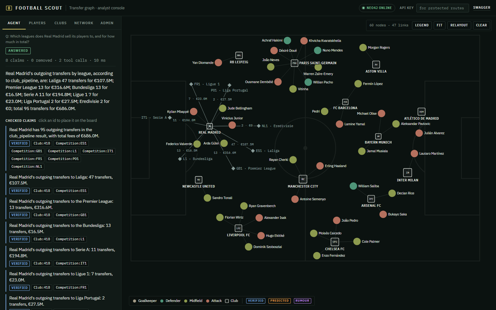
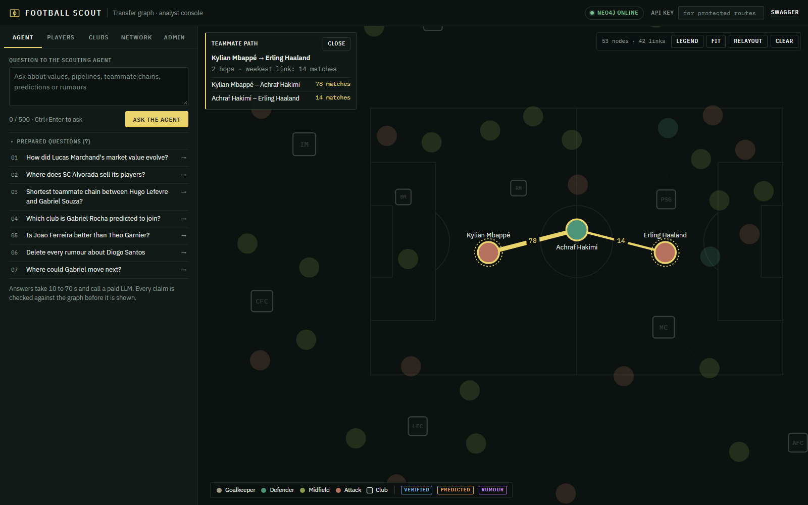
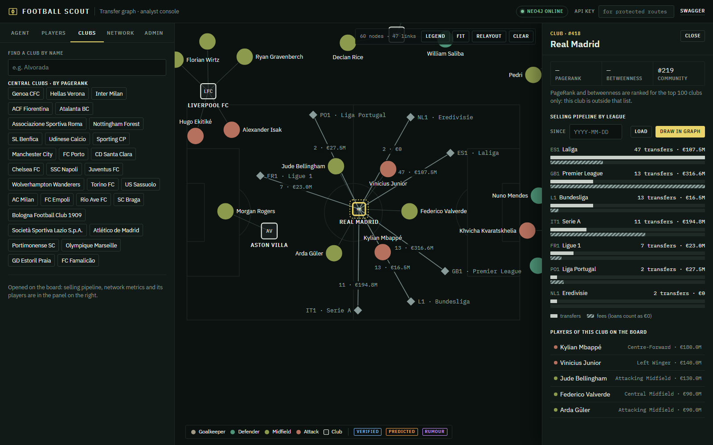
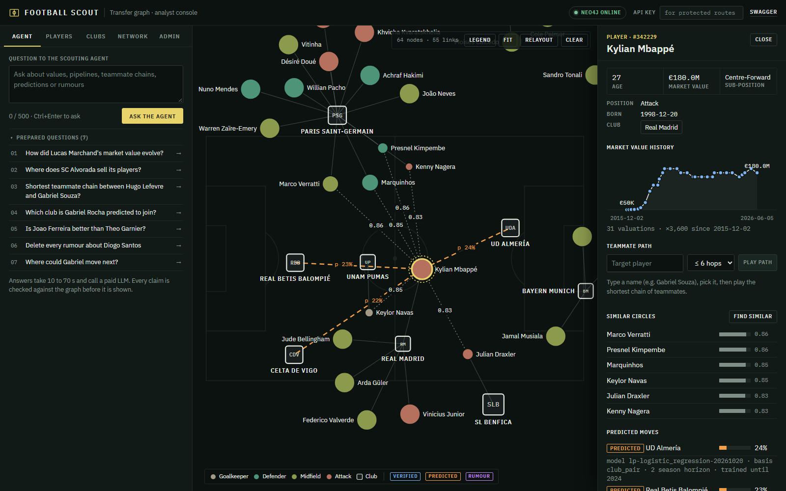
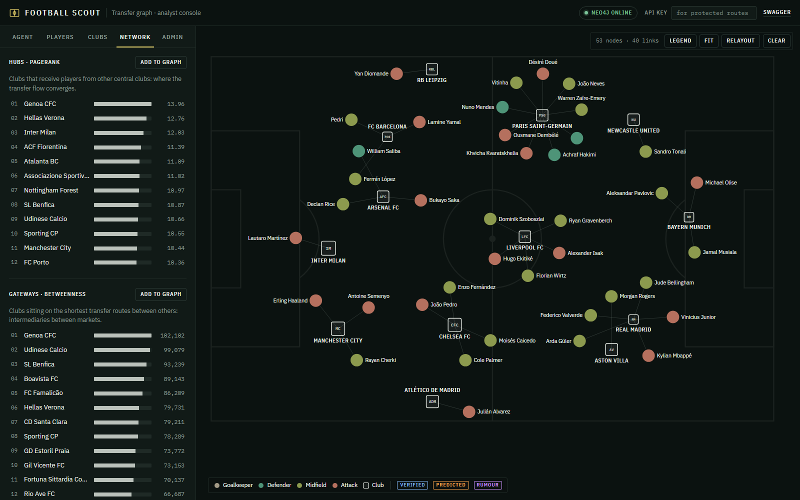
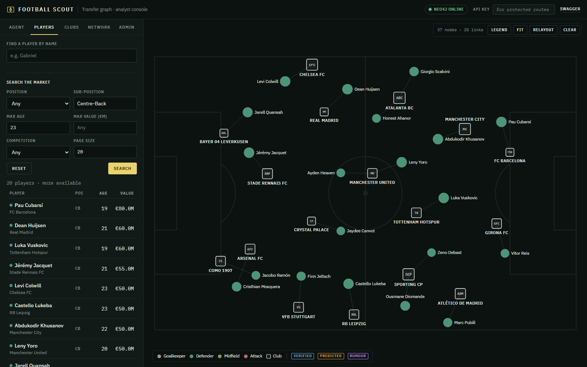
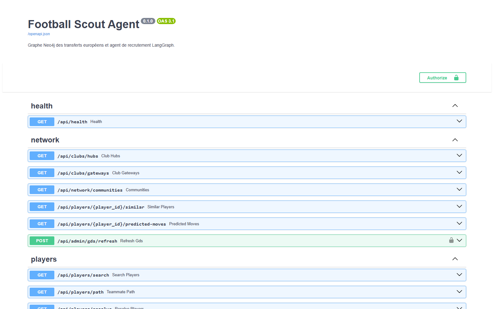
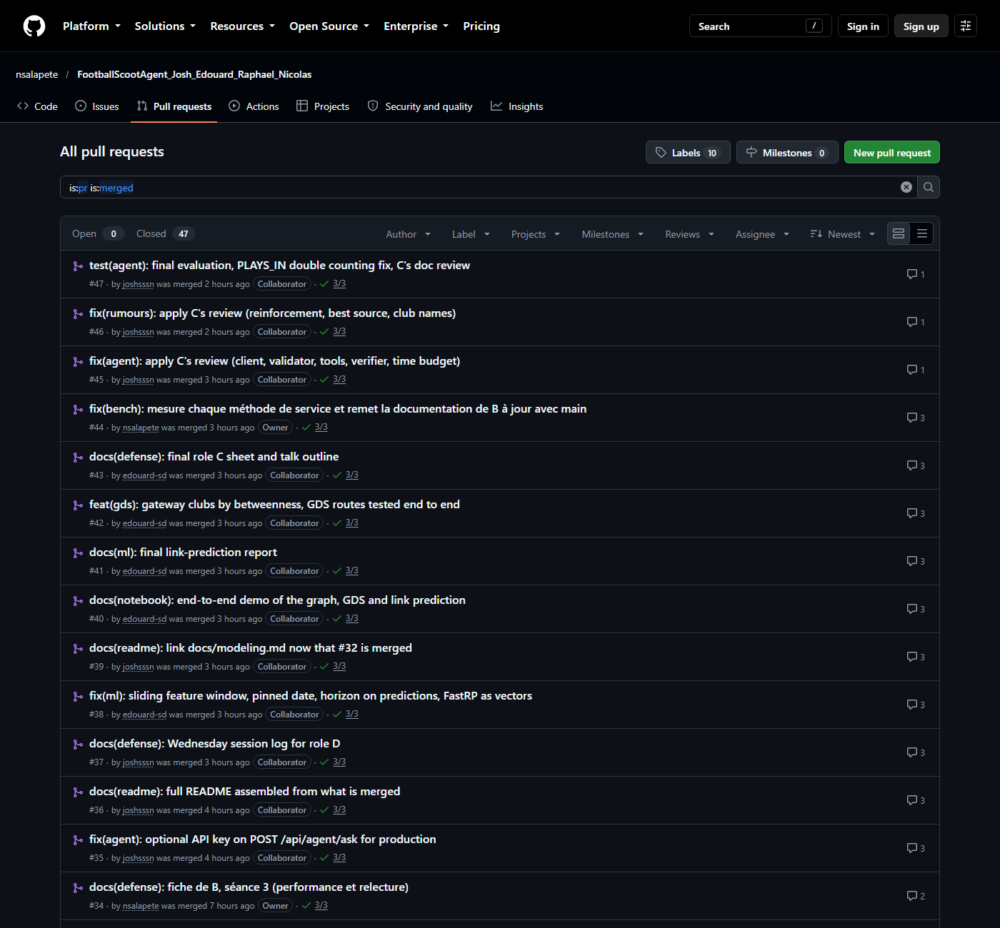

# Football Scout Agent

[](https://github.com/nsalapete/FootballScootAgent_Josh_Edouard_Raphael_Nicolas/actions/workflows/lint.yml)
[](https://github.com/nsalapete/FootballScootAgent_Josh_Edouard_Raphael_Nicolas/actions/workflows/test.yml)
[](https://github.com/nsalapete/FootballScootAgent_Josh_Edouard_Raphael_Nicolas/actions/workflows/publish.yml)

A Neo4j knowledge graph of European football transfers (Transfermarkt, 7 leagues since 2015), a FastAPI API on top
of it, graph data science and link prediction, and a **LangGraph recruitment agent**.
Graph Databases project, AIDAMS 3rd year, level 3+ (agentic / GraphRAG).

The agent answers questions such as *"Which left-backs under 23 cost less than 10 M€?"*, *"Where does Real Madrid
sell its players?"* or *"Which clubs is Bukayo Saka predicted to join?"*. Each statement in an answer is labelled
with one of three **levels of truth**, which are never mixed:

| Level | Comes from | Shown as |
| --- | --- | --- |
| Facts | Transfermarkt data (players, clubs, transfers, valuations) and what is computed from them | `verified` |
| Predictions | link-prediction model (`PREDICTED_MOVE`, `PREDICTED_LINK`) | `predicted` |
| Rumours | press articles read by an LLM (`Rumour`), until confirmed by a real transfer | `rumour` |

Every claim carries graph ids as evidence (`Player:12`, `Transfer:t01`, `Rumour:r1`). A deterministic verifier
removes any claim whose evidence or figures cannot be found in the graph.

## Contents

- [Quick start](#quick-start)
- [Demo interface](#demo-interface)
- [Make commands](#make-commands)
- [API](#api)
- [Architecture and performance](#architecture-and-performance)
- [Graph model and data](#graph-model-and-data)
- [Graph data science and link prediction](#graph-data-science-and-link-prediction)
- [Agent, guardrails and rumours](#agent-guardrails-and-rumours)
- [Quality](#quality)
- [Repository layout](#repository-layout)
- [Team and contributions](#team-and-contributions)
- [Screenshots](#screenshots)

## Quick start

**Demo in one command** (Docker running, Python 3.11+, dependencies installed with `make install` or
`pip install -r requirements.txt`):

```bash
python -m scripts.start_demo          # Windows: .venv\Scripts\python -m scripts.start_demo
```

It starts Neo4j + GDS in Docker (container `scout-neo4j-demo`, port 7690, data kept in a volume), downloads the
Transfermarkt file if needed, loads the real graph and trains the link-prediction model the first time (about
4 minutes, then a few seconds), recomputes the GDS scores, starts the API on the first free port from 8000 and opens
the interface. Options: `--mini` serves the fictitious test graph instead (ready in about 40 s), `--import-rumours`
reads press rumours first (a few cents of LLM), `--api-key`, `--port`, `--no-browser`, and `--stop` stops Neo4j.

**Full stack** (Compose, nginx in front). Requirements: Docker (with Compose), Python 3.11+, `make` (on Windows: Git Bash plus `make`, e.g.
`choco install make`), and about 2 GB of free RAM for Neo4j.

```bash
make env            # creates .env from .env.example: set NEO4J_PASSWORD, API_KEY and the LLM settings
make install        # virtual environment + dependencies
make data           # downloads the Transfermarkt DuckDB file (about 200 MB) into data/
make docker-up      # proxy (:80), api, neo4j (+ GDS), ingest (loads the graph once, about 1 min 15 s)
```

Then open the interface at <http://localhost/ui> and Swagger at <http://localhost/docs>.

**LLM settings in `.env`** (`app/llm/client.py`):

| `LLM_PROVIDER` | Also set | Notes |
| --- | --- | --- |
| `anthropic` | `ANTHROPIC_API_KEY`, `LLM_MODEL_SMALL`, `LLM_MODEL_LARGE` | Claude |
| `openai_compatible` | `LLM_BASE_URL`, `OPENAI_API_KEY`, and the two models | any OpenAI-compatible API (the evaluation used NanoGPT) |
| `fake` | nothing | deterministic, no network; used by the tests and the CI |

The small model routes questions and extracts rumours; the large one plans and writes the answers.

**Production switches:**
- `API_KEY` protects the routes that write to the graph or spend LLM credit (`X-API-Key` header).
- `AGENT_REQUIRE_API_KEY=true` extends that protection to the agent.

The published image can replace a local build:
`API_IMAGE=ghcr.io/nsalapete/football-scout-api:latest docker compose up -d --no-build`
(see [`docs/architecture.md`](docs/architecture.md#image-docker-publiée)).

**Without Docker for the API:** `make run` starts uvicorn on `:8000` against the Neo4j set in `.env`, and
`make seed` loads the graph.

**Offline jobs:**
- `python -m scripts.confirm_rumours` confirms, contradicts or expires pending rumours against the transfers.
- `python -m ml.train_link_prediction` trains the link-prediction model and writes the predictions.
- `python -m scripts.import_articles` imports press rumours (spends LLM credit).

## Demo interface

The API serves a single-page analyst console at `/ui` (`/` redirects to it): plain JavaScript and a vendored copy
of D3, no build step, same origin as the API. It calls every route of the API, and a test checks that it calls no
other (`tests/test_d_ui.py`).

- **Agent.** Ask a question; the answer is shown claim by claim with its truth level (`verified`, `predicted`,
  `rumour`), the evidence ids (a click places the entity on the board), the removed claims with their reason, and
  the tool trace. The prepared questions follow the loaded graph (real or mini) and include the traps.
- **Board.** A D3 force graph on a pitch: players coloured by position, clubs, competitions. A teammate path plays
  hop by hop with the number of matches played together; a club fans out its selling pipeline by league; predicted
  moves are dashed amber, rumours dotted purple, and the legend uses the same badges as the claims.
- **Players, Clubs, Network, Admin tabs.** Search with filters and cursor pagination, name resolution, value
  history, similar players, predicted moves, rumours with source and confidence, PageRank hubs, betweenness
  gateways, Louvain communities, GDS refresh and rumour import (both need the API key, kept in the tab's session
  storage only).
- **Deep links** for the demo: `/ui?player=342229` (Mbappé), `/ui?path=342229-418560` (Mbappé → Haaland),
  `/ui?club=418` (Real Madrid), `/ui?tab=network`, `/ui?q=<question>&ask=1`, and `/ui?selftest=1`, which calls
  every read route and checks the shape of each answer.

API data never goes through `innerHTML`, links only open `http(s)` URLs, and only three whitelisted files are served
under `/ui/`. Screenshots: [below](#screenshots).

## Make commands

| Command | What it does |
| --- | --- |
| `make help` | List the commands |
| `make env` | Create `.env` from `.env.example` (never overwrites) |
| `make venv` / `make install` | Create the virtual environment / install `requirements.txt` |
| `make data` | Download the Transfermarkt DuckDB file into `data/` |
| `make seed` | Load DuckDB into the Neo4j of `.env` (`scripts.seed_data`, idempotent) |
| `make run` | API in development mode on `:8000` |
| `make docker-build` / `docker-run` / `docker-up` / `docker-logs` / `docker-down` | Build, run in the foreground, run in the background, follow the logs, stop the stack |
| `make test-db` / `make test-db-stop` | Disposable test Neo4j (+ GDS) on port 7688, loaded with the mini graph by pytest |
| `make test` | pytest with coverage |
| `make lint` | pylint on `app scripts ml` (threshold 9.5) |
| `make format` | black |
| `make bench-db` / `bench-data` / `bench` / `bench-db-stop` | Benchmark Neo4j on port 7689, synthetic 50,000-player graph, p50/p95 and `PROFILE` plans |
| `make clean` / `make tree` | Remove caches / show the tree |

## API

Base URL: `http://localhost` behind the proxy, or `http://localhost:8000` with `make run`. 🔑 marks the routes that
require `X-API-Key`. Full examples with real outputs for each route:
[`docs/architecture.md`](docs/architecture.md#exemples-curl-de-chaque-endpoint).

| Route | Purpose | Role |
| --- | --- | --- |
| `GET /api/health` | API and Neo4j status | B |
| `GET /api/players/search` | Players by position, sub-position, max age, max value, competition (cursor pagination) | B |
| `GET /api/players/resolve`, `GET /api/clubs/resolve` | Names to ids through the full-text indexes (tolerates a typo) | B |
| `GET /api/players/{id}`, `GET /api/players/{id}/valuations` | One player; market-value history | B |
| `GET /api/players/path?from=&to=` | Shortest chain of teammates (6 hops at most) | B |
| `GET /api/clubs/{id}/pipeline` | Where a club sells its players, by destination competition | B |
| `GET /api/clubs/hubs`, `GET /api/clubs/gateways`, `GET /api/network/communities` | PageRank hubs, betweenness gateways, Louvain communities | C |
| `GET /api/players/{id}/similar`, `GET /api/players/{id}/predicted-moves` | FastRP neighbours; predicted destinations | C |
| `POST /api/admin/gds/refresh` 🔑 | Recompute the projections and algorithms | C |
| `GET /api/players/{id}/rumours` | Press rumours with source, status and confidence | D |
| `POST /api/rumours/import` 🔑 | Import articles and extract rumours with the LLM | D |
| `POST /api/agent/ask` (🔑 if `AGENT_REQUIRE_API_KEY=true`) | Ask the agent; the answer exposes claims, removed claims and the tool trace | D |

```bash
BASE=http://localhost
curl "$BASE/api/players/search?position=Defender&sub_position=Left-Back&max_age=23&max_value_eur=15000000&limit=2"
curl "$BASE/api/players/path?from=1&to=4"
curl "$BASE/api/clubs/7/pipeline"
curl -X POST "$BASE/api/agent/ask" -H "Content-Type: application/json" \
     -d '{"question": "How did Lucas Marchand'"'"'s market value evolve?"}'
```

## Architecture and performance

Owner: B. Details in [`docs/architecture.md`](docs/architecture.md) (diagram:
[`docs/architecture.drawio`](docs/architecture.drawio)), [`docs/perf.md`](docs/perf.md) and
[`docs/decisions/b.md`](docs/decisions/b.md).

- **Docker Compose stack.** Four services:
  - `proxy` (nginx), the only published port (80);
  - `api` (FastAPI);
  - `neo4j` (Neo4j 5 + GDS), bound to `127.0.0.1` only;
  - `ingest`, which loads the graph once.

  Healthchecks order the start-up.
- **Layers.** Routers → services → `Neo4jClient`. Routers hold no Cypher, and every query is parameterised and
  runs in a read or write transaction with a timeout. The agent calls the same services as the API.
- **Security.**
  - nginx limits requests to 20 per second per IP, and to 10 per minute for the agent, the GDS refresh and the
    rumour import.
  - Security headers are set.
  - `X-API-Key` is compared in constant time.
  - Secrets live only in `.env`.
- **Published image.** Each push on `main` publishes the API image to GHCR (`latest`, `sha-<commit>`); the release
  tags add `v1.0.0` and `v1.0`.
- **Performance.** Measured on a synthetic graph of 50,000 players and 890,000 relationships:
  - every method of B's services answers in under 21 ms at p50 and 40 ms at p95;
  - every query starts from a uniqueness constraint or an index;
  - `docs/perf.md` shows `PROFILE` plans before and after the indexes, cursor against `SKIP` pagination, and
    bounded against unbounded shortest paths.

## Graph model and data

Owner: A. The schema contract is [`docs/schema.md`](docs/schema.md) (constraints and indexes:
`scripts/constraints.cypher`). The modeling rationale, data sources and anti-genericity appendix are in
[`docs/modeling.md`](docs/modeling.md) (diagram: [`docs/schema.drawio`](docs/schema.drawio), open it in
[draw.io](https://app.diagrams.net)). The source tables and how they map to the graph:
[`docs/source_er_diagram.md`](docs/source_er_diagram.md) (ER diagram of the DuckDB file).

```
(:Player)-[:MADE]->(:Transfer)-[:FROM|TO]->(:Club)-[:PLAYS_IN {season}]->(:Competition)-[:IN_COUNTRY]->(:Country)
(:Player)-[:PLAYS_FOR]->(:Club)   (:Player)-[:HAS_VALUATION]->(:Valuation)   (:Player)-[:CITIZEN_OF]->(:Country)
(:Player)-[:PLAYED_WITH {matches}]-(:Player)            (:Club)-[:SENDS_TO {count, total_fee_eur}]->(:Club)
(:Article)-[:REPORTS]->(:Rumour)-[:ABOUT]->(:Player)    (:Rumour)-[:TARGET]->(:Club)   (:Rumour)-[:CONFIRMED_BY]->(:Transfer)
(:Player)-[:PREDICTED_MOVE {prob, model_version, horizon_seasons, trained_until}]->(:Club)
(:Club)-[:PREDICTED_LINK {prob, model_version, horizon_seasons, trained_until}]->(:Club)
```

Key choices:
- **A transfer is a node.** It has three ends, and a confirmed rumour points to it.
- **Appearances are not loaded.** They are aggregated in DuckDB into `PLAYED_WITH` pairs.
- **`SENDS_TO` is materialised** for the club network and GDS.
- **The league depends on the season** (`PLAYS_IN {season}`), because clubs are promoted and relegated.
- **Hypotheses use their own labels and relationship types**, so a query on facts can never see them.

**Data.** [transfermarkt-datasets](https://github.com/dcaribou/transfermarkt-datasets) (CC0, DuckDB file), with the
scope set by `SCOPE_COMPETITIONS` (`GB1, ES1, IT1, L1, FR1, PO1, NL1`) and `SCOPE_FROM_SEASON` (`2015`). Press
articles come from the Guardian transfer-window, BBC gossip and Sky Sports transfer RSS feeds and the GDELT DOC API.

**Ingestion** (`scripts/seed_data.py`, rules in `scripts/data_quality.py`):
- idempotent, extraction in DuckDB, then `MERGE` in batches of 5,000;
- data-quality rules for loans, placeholder clubs, duplicates and future-dated moves;
- a full load takes about 1 min 15 s.

Decisions: [`docs/decisions/a.md`](docs/decisions/a.md).

## Graph data science and link prediction

Owner: C. Details in [`docs/ml_report.md`](docs/ml_report.md), the notebook [`demo.ipynb`](demo.ipynb) and
[`docs/decisions/c.md`](docs/decisions/c.md).

**GDS** (`app/services/gds.py`) projects the club network and the teammate network, then runs:
- weighted PageRank on `SENDS_TO`, for transfer hubs: a high score marks a club that **receives** players from
  other central clubs, not the biggest seller;
- betweenness on `SENDS_TO`, for gateways: clubs that sit on many seller-to-buyer routes;
- Louvain, for communities of clubs (transfer pipelines);
- FastRP on `PLAYED_WITH`, for player embeddings: "similar" means shared teammate circles, not the same position.

The scores are written back to the nodes, so reads stay cheap. A full refresh takes about 9 s on a freshly started
server (GDS warm-up), then under 3 s (`docs/perf.md`, synthetic graph); C measured 12.6 s on the real graph.

**Link prediction** (`ml/`) asks which club pairs that never traded will trade within two seasons:
- the protocol is temporal, so no future information leaks into training;
- the features are common neighbours, Adamic-Adar, preferential attachment, same country and PageRank gap;
- the chosen logistic regression reaches a test AUC-PR of 0.166, against 0.126 for the common-neighbours baseline
  and 0.036 at random;
- among its 50 most probable new pairs, 17 did trade in 2023-2024, against 8 for the baseline and 1.8 at random.

The predictions are written as `PREDICTED_LINK` / `PREDICTED_MOVE`, always labelled `predicted`. A move's
probability is the one of the pair (player's current club, destination club) trading within two seasons: the same
for every player of a club (`basis: "club_pair"` in the API), never "this player will join".

## Agent, guardrails and rumours

Owner: D. Details in [`docs/guardrails.md`](docs/guardrails.md), [`docs/agent_eval.md`](docs/agent_eval.md) and
[`docs/decisions/d.md`](docs/decisions/d.md).

```
question → router (rules, then small model) → planner (large model + tools, ≤ 6 calls) → writer → verifier → answer
```

- **Router.** It refuses level judgements, betting, scores, write requests and off-topic questions; obvious cases
  are caught by rules, with no LLM call. On an ambiguous name ("Gabriel"), it asks which player is meant instead
  of guessing.
- **Tools.**
  - The agent has twelve tools. Eleven are parameterised and each calls one service method: `resolve_entity`,
    `search_players`, `player_profile`, `club_pipeline`, `teammate_path`, `value_trend`, `similar_players`,
    `club_hubs`, `transfer_gateways`, `predicted_moves` and `rumours`. The twelfth is `cypher_fallback`.
  - `cypher_fallback` is the last resort. Its query must pass `CypherValidator`: read-only, schema allow-lists,
    `LIMIT ≤ 100`, paths of 6 hops at most, a single statement, no `$parameters`, no GDS procedure, strings and
    comments ignored. It then runs in a read transaction.
- **Verifier.** It is deterministic. Each claim keeps its place only if:
  - its evidence ids exist in the graph and were returned by a tool;
  - every number it cites appears in a tool result;
  - its nature matches its source (a rumour or a prediction can never be `verified`).

  Otherwise the claim moves to `removed_claims` with a reason, and the answer is rebuilt without it.
- **Rumours.**
  - **Extraction.** The small LLM reads RSS or GDELT articles. The extracted quote must appear in the article, and
    names are resolved against the graph: a name that does not match exactly one node is counted, never guessed.
  - **Confirmation.** A rumour stays `pending` until `scripts/confirm_rumours.py` (A) links it to a real transfer.
  - **Confidence.** The displayed confidence is the extraction confidence × the smoothed reliability of the
    source.
- **Evaluation.** 40 questions on the mini graph, 10 of them traps, with NanoGPT models:

  | | Run 1 | Run 2 | Run 3 (final) |
  | --- | --- | --- | --- |
  | Correct answers | 26 / 40 | 39 / 40 | **38 / 40** |
  | Traps handled | 10 / 10 | 10 / 10 | 10 / 10 |
  | Claims removed | 34 | 5 | 0 |
  | Mean latency | 49 s | 40 s | 23 s (p95 68 s) |
  | Cost of the run | $0.12 | $0.11 | $0.04 |

  Run 3 used DeepSeek as the large model, after C's review. Its two failures came from a missing `LIMIT` that the
  time budget left no turn to fix; the tool now adds it, and both questions pass.

  `docs/agent_eval.md` explains what changed between the three runs. Re-run with `python -m scripts.agent_eval`.
- **Checked on the real graph.** The evaluation needs known answers, so it runs on the mini graph. The agent and the
  rumour import were then run on the real graph (17,856 players). That found seven problems the mini graph could
  not show, all fixed with a test:
  - the router refused *"Paris Saint-Germain"* as a betting question (`paris`), a PageRank *score* as a match score
    and a value that *drops* as a write request: the rules now catch only unambiguous phrasings;
  - "Benfica" or "Real Madrid" also match their U19, B and reserve teams, so the agent asked which one was meant and
    the rumour import left most club names unresolved: first teams now win unless the question names a youth team;
  - the full-text index finds nothing for "PSG", "Man Utd" or "Barça": a short list of nicknames is expanded first;
  - generated queries compared dates with strings (always null): the schema given to the planner says how to
    compare them;
  - the club pipeline did not echo its `since` filter, so the writer could not confirm "since 2020";
  - "similar players" (FastRP on teammates) read like a playing-style match: the writer now says what it means;
  - the Guardian moved its transfers feed and the general BBC feed had almost no transfer news: the default feeds
    were replaced.

  With these fixes, 14 real questions in English and French (values, paths, pipelines, predictions, hubs, PSG's
  purchases from Premier League clubs, Benfica's sales to the Premier League, and three traps) were all handled
  correctly. The verifier removed one claim, which cited no evidence. Answers took 13 to 70 s; refusals took 2 s,
  with no LLM call.

## Quality

- **CI** (GitHub Actions) runs three workflows:
  - `lint`: pylint ≥ 9.5 on `app scripts ml` (currently 10.00);
  - `tests`: pytest against a Neo4j 5 + GDS service container loaded with the mini graph;
  - `publish`: the Docker image on GHCR.
- **Mini graph.** [`tests/fixtures/mini_graph.cypher`](tests/fixtures/mini_graph.cypher) holds fictitious data
  whose expected answers are listed in [`tests/fixtures/README.md`](tests/fixtures/README.md). Every role tests
  against it, and tests that write create and remove their own data.
- **No real LLM in tests.** `LLM_PROVIDER=fake` is forced by `tests/conftest.py`: the agent is tested with a
  scripted model that returns tool calls and structured outputs.
- **Defence sheets.** Each member's choices, rejected alternatives and likely questions are in
  [`docs/defense/`](docs/defense).

## Repository layout

```
app/
  main.py, config.py, security.py      FastAPI app, settings, API key (B)
  static/ui/, routers/ui.py            demo interface served at /ui (D)
  database/neo4j.py                    Neo4jClient: parameterised reads and writes with a timeout (A)
  models/  routers/  services/         Pydantic models, HTTP routes, Cypher queries (one file per area)
  agent/                               LangGraph agent, tools, Cypher validator, evidence checks (D)
  llm/client.py                        chat models: anthropic, openai_compatible, fake (D)
scripts/                               ingestion, data quality, rumour confirmation (A), benchmarks (B),
                                       article import, agent evaluation, one-command demo (D)
ml/                                    link-prediction dataset and training (C)
tests/                                 pytest, one file per role and area; fixtures/ = mini graph
docs/                                  architecture, perf, schema, ML report, guardrails, evaluation, decisions, defense
nginx/  Dockerfile  docker-compose.yml  Makefile  .github/workflows/
```

## Team and contributions

| Role | Member | Scope | Commits | Share | Merged PRs |
| --- | --- | --- | ---: | ---: | --- |
| A · data, lead | Raphael Hazan ([@raphaelhazan](https://github.com/raphaelhazan)) | schema, ingestion, data quality, rumour confirmation, CI | 18 | 15.1 % | 5: [#13](https://github.com/nsalapete/FootballScootAgent_Josh_Edouard_Raphael_Nicolas/pull/13), [#14](https://github.com/nsalapete/FootballScootAgent_Josh_Edouard_Raphael_Nicolas/pull/14), [#15](https://github.com/nsalapete/FootballScootAgent_Josh_Edouard_Raphael_Nicolas/pull/15), [#16](https://github.com/nsalapete/FootballScootAgent_Josh_Edouard_Raphael_Nicolas/pull/16), [#32](https://github.com/nsalapete/FootballScootAgent_Josh_Edouard_Raphael_Nicolas/pull/32) |
| B · API, Docker | Nicolas Salapete ([@nsalapete](https://github.com/nsalapete)) | API, services, Docker, nginx, image publishing, benchmarks | 35 | 29.4 % | 10: [#5](https://github.com/nsalapete/FootballScootAgent_Josh_Edouard_Raphael_Nicolas/pull/5), [#6](https://github.com/nsalapete/FootballScootAgent_Josh_Edouard_Raphael_Nicolas/pull/6), [#7](https://github.com/nsalapete/FootballScootAgent_Josh_Edouard_Raphael_Nicolas/pull/7), [#8](https://github.com/nsalapete/FootballScootAgent_Josh_Edouard_Raphael_Nicolas/pull/8), [#9](https://github.com/nsalapete/FootballScootAgent_Josh_Edouard_Raphael_Nicolas/pull/9), [#17](https://github.com/nsalapete/FootballScootAgent_Josh_Edouard_Raphael_Nicolas/pull/17), [#18](https://github.com/nsalapete/FootballScootAgent_Josh_Edouard_Raphael_Nicolas/pull/18), [#33](https://github.com/nsalapete/FootballScootAgent_Josh_Edouard_Raphael_Nicolas/pull/33), [#34](https://github.com/nsalapete/FootballScootAgent_Josh_Edouard_Raphael_Nicolas/pull/34), [#44](https://github.com/nsalapete/FootballScootAgent_Josh_Edouard_Raphael_Nicolas/pull/44) |
| C · GDS, ML | Edouard Souied ([@edouard-sd](https://github.com/edouard-sd)) | GDS algorithms, link prediction, notebook | 25 | 21.0 % | 13: [#10](https://github.com/nsalapete/FootballScootAgent_Josh_Edouard_Raphael_Nicolas/pull/10), [#11](https://github.com/nsalapete/FootballScootAgent_Josh_Edouard_Raphael_Nicolas/pull/11), [#12](https://github.com/nsalapete/FootballScootAgent_Josh_Edouard_Raphael_Nicolas/pull/12), [#23](https://github.com/nsalapete/FootballScootAgent_Josh_Edouard_Raphael_Nicolas/pull/23), [#25](https://github.com/nsalapete/FootballScootAgent_Josh_Edouard_Raphael_Nicolas/pull/25), [#27](https://github.com/nsalapete/FootballScootAgent_Josh_Edouard_Raphael_Nicolas/pull/27), [#28](https://github.com/nsalapete/FootballScootAgent_Josh_Edouard_Raphael_Nicolas/pull/28), [#29](https://github.com/nsalapete/FootballScootAgent_Josh_Edouard_Raphael_Nicolas/pull/29), [#38](https://github.com/nsalapete/FootballScootAgent_Josh_Edouard_Raphael_Nicolas/pull/38), [#40](https://github.com/nsalapete/FootballScootAgent_Josh_Edouard_Raphael_Nicolas/pull/40), [#41](https://github.com/nsalapete/FootballScootAgent_Josh_Edouard_Raphael_Nicolas/pull/41), [#42](https://github.com/nsalapete/FootballScootAgent_Josh_Edouard_Raphael_Nicolas/pull/42), [#43](https://github.com/nsalapete/FootballScootAgent_Josh_Edouard_Raphael_Nicolas/pull/43) |
| D · agent, rumours | Josh Soussan ([@joshsssn](https://github.com/joshsssn)) | LLM client, LangGraph agent, guardrails, rumours, evaluation, demo interface, README | 41 | 34.5 % | 20: [#1](https://github.com/nsalapete/FootballScootAgent_Josh_Edouard_Raphael_Nicolas/pull/1), [#2](https://github.com/nsalapete/FootballScootAgent_Josh_Edouard_Raphael_Nicolas/pull/2), [#3](https://github.com/nsalapete/FootballScootAgent_Josh_Edouard_Raphael_Nicolas/pull/3), [#4](https://github.com/nsalapete/FootballScootAgent_Josh_Edouard_Raphael_Nicolas/pull/4), [#19](https://github.com/nsalapete/FootballScootAgent_Josh_Edouard_Raphael_Nicolas/pull/19), [#20](https://github.com/nsalapete/FootballScootAgent_Josh_Edouard_Raphael_Nicolas/pull/20), [#21](https://github.com/nsalapete/FootballScootAgent_Josh_Edouard_Raphael_Nicolas/pull/21), [#22](https://github.com/nsalapete/FootballScootAgent_Josh_Edouard_Raphael_Nicolas/pull/22), [#24](https://github.com/nsalapete/FootballScootAgent_Josh_Edouard_Raphael_Nicolas/pull/24), [#26](https://github.com/nsalapete/FootballScootAgent_Josh_Edouard_Raphael_Nicolas/pull/26), [#30](https://github.com/nsalapete/FootballScootAgent_Josh_Edouard_Raphael_Nicolas/pull/30), [#31](https://github.com/nsalapete/FootballScootAgent_Josh_Edouard_Raphael_Nicolas/pull/31), [#35](https://github.com/nsalapete/FootballScootAgent_Josh_Edouard_Raphael_Nicolas/pull/35), [#36](https://github.com/nsalapete/FootballScootAgent_Josh_Edouard_Raphael_Nicolas/pull/36), [#37](https://github.com/nsalapete/FootballScootAgent_Josh_Edouard_Raphael_Nicolas/pull/37), [#39](https://github.com/nsalapete/FootballScootAgent_Josh_Edouard_Raphael_Nicolas/pull/39), [#45](https://github.com/nsalapete/FootballScootAgent_Josh_Edouard_Raphael_Nicolas/pull/45), [#46](https://github.com/nsalapete/FootballScootAgent_Josh_Edouard_Raphael_Nicolas/pull/46), [#47](https://github.com/nsalapete/FootballScootAgent_Josh_Edouard_Raphael_Nicolas/pull/47), [#48](https://github.com/nsalapete/FootballScootAgent_Josh_Edouard_Raphael_Nicolas/pull/48) |
| **Total** | | | **119** | **100 %** | **48** |

Commits from `git shortlog -sn --no-merges main` (merge commits excluded), merged PRs from
`gh pr list --state merged --author <login>`, both counted on 21/10/2026 for the v1.0 release. All merged PRs:
[FootballScootAgent_Josh_Edouard_Raphael_Nicolas/pulls?q=is:pr+is:merged](https://github.com/nsalapete/FootballScootAgent_Josh_Edouard_Raphael_Nicolas/pulls?q=is%3Apr+is%3Amerged). Josh's count includes the
shared project skeleton, and Nicolas's the initial commit.

The work is spread across the four roles: every member owns one layer end to end (data, API, graph data science,
agent), with a commit share between 15 % and 35 % and at least five merged PRs each. Reviews follow a rota
(A reviews B, B reviews C, C reviews D, D reviews A); the review comments on B's PRs were posted by Josh in A's
slot.

## Screenshots

All on the real graph, from the demo interface unless stated.

| | |
| --- | --- |
|  |  |
| Agent: *"Which leagues does Real Madrid sell its players to?"*, 8 verified claims with their evidence | Shortest teammate chain, played hop by hop |
|  |  |
| Club drawer: selling pipeline by league | Player drawer: value history, similar players, predicted moves |
|  |  |
| PageRank hubs and betweenness gateways | Players search: centre-backs under 23 |
|  |  |
| Swagger (`/docs`) | Merged pull requests on GitHub |

License: [MIT](LICENSE).
