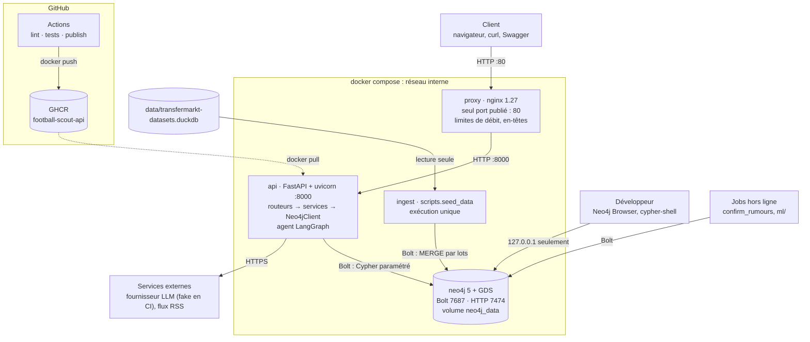

# Architecture

Owner : B. Diagramme éditable : [`architecture.drawio`](architecture.drawio) (ouvrir avec <https://app.diagrams.net>
ou l'extension VS Code « Draw.io Integration ») ; la même architecture en Mermaid ci-dessous, rendue directement
par GitHub.

## Vue d'ensemble



## Services et ports

| Service | Rôle | Port dans le conteneur | Publié sur l'hôte | Qui s'y connecte |
| --- | --- | --- | --- | --- |
| `proxy` (nginx 1.27) | point d'entrée unique, limites de débit, en-têtes de sécurité | 80 | `0.0.0.0:80` | clients |
| `api` (FastAPI, uvicorn) | API REST, Swagger, agent | 8000 | **non** (`expose` seulement) | `proxy` |
| `neo4j` (Neo4j 5 + GDS) | graphe | 7687 (Bolt), 7474 (HTTP) | `127.0.0.1` seulement | `api`, `ingest`, développeurs de la machine |
| `ingest` | chargement DuckDB → Neo4j, une fois puis s'arrête | aucun | aucun | — |
| `scout-neo4j-test` (`make test-db`) | base jetable des tests, chargée avec le mini-graphe | 7687 | `7688` | pytest, CI |
| `scout-neo4j-bench` (`make bench-db`) | base des benchmarks (gros graphe synthétique) | 7687 | `7689` | `scripts/benchmark.py` |
| uvicorn local (`make run`) | développement sans Docker | 8000 | `8000` | développeur |

Ordre de démarrage garanti par les healthchecks : `neo4j` sain (`cypher-shell 'RETURN 1'`) → `api` et `ingest` ;
`api` saine (`GET /api/health`) → `proxy`. Volumes : `neo4j_data` (données du graphe), `./data` monté dans `ingest`
(fichier DuckDB). Configuration : `.env` (créé par `make env` à partir de `.env.example`).

## Couches dans l'API

```text
requête HTTP
  └─ routeur (app/routers/*.py)      validation Pydantic → 422 ; 404 si l'entité n'existe pas
       └─ service (app/services/*.py) une méthode = une requête Cypher constante et paramétrée
            └─ Neo4jClient (app/database/neo4j.py)  transaction read ou write, délai de 10 s
                 └─ Neo4j
```

- Les routeurs ne contiennent pas de Cypher ; les services ne connaissent pas HTTP. L'agent (D) appelle les mêmes
  services que les routeurs, avec les mêmes garanties (paramètres, `LIMIT`, chemins bornés).
- Les lectures passent par `execute_read` : le serveur refuse toute écriture qu'elles contiendraient.
- Erreurs transverses (`app/main.py`) : `RequestValidationError` → 422 `ErrorResponse`, `NotImplementedError` → 501,
  `ServiceUnavailable` (Neo4j arrêté) → 503.

## Flux

1. **Lecture** (recherche, chemin, filière…) : client → nginx (limite 20 req/s par IP) → routeur (validation) →
   service → `Neo4jClient.read` → JSON. Aucun appel externe.
2. **Question à l'agent** (`POST /api/agent/ask`) : nginx (limite 10 req/min par IP) → `ScoutAgent` (LangGraph :
   routage, planification, appels d'outils, rédaction, vérification des preuves) → outils = méthodes des services
   (et, en dernier recours, un Cypher généré puis validé par `CypherValidator`, exécuté en lecture) → fournisseur LLM
   en HTTPS. Chaque affirmation est étiquetée `verified`, `predicted` ou `rumour` avec ses preuves `Label:id`.
3. **Import de rumeurs** (`POST /api/rumours/import`, clé d'API) : flux RSS → extraction par le LLM → nœuds
   `Article` et `Rumour` ; `scripts.confirm_rumours` les confirme ensuite face aux vrais transferts.
4. **Recalcul GDS** (`POST /api/admin/gds/refresh`, clé d'API) : projections en mémoire, PageRank, Louvain, FastRP,
   écrits sur les nœuds (`pagerank`, `community_id`, `embedding`) pour que les lectures restent simples.
5. **Ingestion** (`ingest` ou `make seed`) : DuckDB Transfermarkt (lecture seule) → contraintes et index → nœuds
   puis relations par lots (`MERGE`, idempotent) → relations dérivées `PLAYED_WITH` et `SENDS_TO`.
6. **CI/CD** : à chaque PR, `lint` (pylint ≥ 9,5) et `tests` (pytest contre un Neo4j de service sur 7688,
   `LLM_PROVIDER=fake`) ; à chaque push sur `main`, `publish` construit l'image et la pousse sur GHCR.

## Sécurité

- Un seul port public (80). L'API n'est joignable qu'à travers nginx ; Neo4j seulement depuis la machine hôte.
- nginx : 20 req/s par IP (rafale 40) ; 10 req/min (rafale 5) pour l'agent, l'admin GDS et l'import de rumeurs ;
  429 au-delà ; corps limité à 1 Mo ; `server_tokens off` ; en-têtes `X-Content-Type-Options: nosniff`,
  `X-Frame-Options: DENY`, `Referrer-Policy: no-referrer`.
- Clé d'API (`X-API-Key`, comparée en temps constant) sur les routes qui écrivent dans le graphe ou dépensent du crédit
  LLM : 401 si elle manque ou est fausse, 503 si `API_KEY` n'est pas configurée côté serveur.
- Cypher toujours paramétré ; secrets uniquement dans `.env` (ni dans l'image, grâce au `.dockerignore`, ni dans Git).
- Limites connues : pas de TLS (à poser sur nginx en production) ; `/api/agent/ask` n'est protégé que par la limite
  de débit.

## Image Docker publiée

Chaque push sur `main` construit l'image de l'API et la publie sur GitHub Container Registry
(workflow `.github/workflows/publish.yml`, authentifié par le `GITHUB_TOKEN` du workflow, droit `packages: write`) :

- `ghcr.io/nsalapete/football-scout-api:latest` : dernier état de `main` ;
- `ghcr.io/nsalapete/football-scout-api:sha-<commit>` : une image par commit, pour revenir en arrière ;
- `ghcr.io/nsalapete/football-scout-api:v1.0` : l'image du tag de rendu.

Page du paquet : <https://github.com/users/nsalapete/packages/container/package/football-scout-api>

Lancer la stack avec l'image publiée au lieu de la reconstruire :

```bash
docker pull ghcr.io/nsalapete/football-scout-api:latest
API_IMAGE=ghcr.io/nsalapete/football-scout-api:latest docker compose up -d --no-build
```

## Exemples `curl` de chaque endpoint

Les réponses de B (santé, joueurs, clubs, erreurs) sont des sorties réelles sur le **mini-graphe de test**
(`tests/fixtures/mini_graph.cypher`, ids fictifs). Pour le recalcul GDS et l'agent, c'est la **forme** de la réponse
(modèles Pydantic) : sur le mini-graphe sans recalcul GDS, les routes de C renvoient `[]`, et avec `LLM_PROVIDER=fake`
l'agent répond une phrase fixe sans affirmation. Sur les données réelles, les ids sont ceux de Transfermarkt : on les
trouve avec les routes `/resolve`.
`BASE=http://localhost` derrière le proxy (`make docker-up`), `http://localhost:8000` avec `make run`.

### Santé

```bash
curl "$BASE/api/health"
# 200 {"status":"ok","neo4j":true}      ("degraded" et false si Neo4j est arrêté)
```

### Joueurs (B)

```bash
# Résolution d'un nom (index full-text, tolère une faute ou un accent manquant)
curl "$BASE/api/players/resolve?name=Gabriel"
# 200 [{"kind":"player","id":8,"name":"Gabriel Souza","score":1.11},
#      {"kind":"player","id":9,"name":"Gabriel Rocha","score":1.11}]

# Recherche filtrée, triée par valeur décroissante, paginée par curseur
curl "$BASE/api/players/search?position=Defender&sub_position=Left-Back&max_age=23&max_value_eur=15000000&limit=2"
curl "$BASE/api/players/search?sub_position=Left-Back&limit=2"
# 200 {"items":[{"player_id":1,"name":"Lucas Marchand","position":"Defender","sub_position":"Left-Back",
#                "date_of_birth":"2003-04-12","market_value_eur":12000000,"club_id":1,"club_name":"Olympique Rivage"},
#               {"player_id":5,"name":"Diogo Santos", ... ,"club_name":"SC Alvorada"}],
#      "next_cursor":"eyJ2Ijo5MDAwMDAwLCJpZCI6NX0"}
curl "$BASE/api/players/search?sub_position=Left-Back&limit=2&cursor=eyJ2Ijo5MDAwMDAwLCJpZCI6NX0"
# 200 {"items":[{"player_id":14,"name":"Nathan Roux", ...}],"next_cursor":null}
curl "$BASE/api/players/search?competition_id=FR1"          # joueurs des clubs de Ligue 1 à la saison la plus récente

# Fiche et historique de valeur
curl "$BASE/api/players/1"
# 200 {"player_id":1,"name":"Lucas Marchand","position":"Defender","sub_position":"Left-Back",
#      "date_of_birth":"2003-04-12","market_value_eur":12000000,"club_id":1,"club_name":"Olympique Rivage"}
curl "$BASE/api/players/1/valuations"
# 200 [{"as_of":"2022-06-30","value_eur":3000000},{"as_of":"2023-06-30","value_eur":7000000},
#      {"as_of":"2024-12-15","value_eur":12000000}]

# Plus court chemin de coéquipiers (PLAYED_WITH, 6 sauts au plus)
curl "$BASE/api/players/path?from=1&to=4"
# 200 {"players":[{"player_id":1,"name":"Lucas Marchand"},{"player_id":6,"name":"Tiago Costa"},
#                 {"player_id":2,"name":"Theo Garnier"},{"player_id":3,"name":"Joao Ferreira"},
#                 {"player_id":4,"name":"Rui Almeida"}],"matches_together":[12,10,30,25],"hops":4}
curl "$BASE/api/players/path?from=1&to=4&max_hops=3"
# 404 {"detail":"Aucun chemin de coéquipiers en 3 sauts ou moins"}
```

### Clubs (B)

```bash
curl "$BASE/api/clubs/resolve?name=Alvorada"
# 200 [{"kind":"club","id":7,"name":"SC Alvorada","score":0.99}]

# Filière : où le club vend, par compétition du club acheteur à la saison du transfert
curl "$BASE/api/clubs/7/pipeline"
# 200 [{"competition_id":"GB1","competition_name":"Premier League","transfers":2,"total_fee_eur":50000000},
#      {"competition_id":"FR1","competition_name":"Ligue 1","transfers":1,"total_fee_eur":9000000},
#      {"competition_id":"PO1","competition_name":"Liga Portugal","transfers":1,"total_fee_eur":0}]
curl "$BASE/api/clubs/7/pipeline?since=2022-08-01&limit=10"
# 200 [{"competition_id":"FR1", ... ,"transfers":1,"total_fee_eur":9000000},
#      {"competition_id":"PO1", ... ,"transfers":1,"total_fee_eur":0}]
```

### Réseau, similarité, prédictions (C)

```bash
curl "$BASE/api/clubs/hubs?limit=10"                 # clubs triés par PageRank pondéré sur SENDS_TO
curl "$BASE/api/network/communities?min_size=2"      # communautés Louvain de clubs (filières)
curl "$BASE/api/players/8/similar?k=5"               # voisins par embedding FastRP
curl "$BASE/api/players/9/predicted-moves?limit=5"   # destinations prédites : hypothèses, nature "predicted"
# Ces routes lisent les scores écrits par le recalcul GDS : listes vides tant qu'il n'a pas tourné.
curl -X POST "$BASE/api/admin/gds/refresh" -H "X-API-Key: $API_KEY"
# 200 rapport {"projections":[...],"algorithms":[...],"duration_s":...}
# 401 {"detail":"Clé d'API absente ou invalide (en-tête X-API-Key)"} sans la clé
```

### Rumeurs et agent (D)

```bash
curl "$BASE/api/players/5/rumours?status=pending"    # rumeurs de presse sur un joueur, nature "rumour"
curl -X POST "$BASE/api/rumours/import" -H "X-API-Key: $API_KEY" \
     -H "Content-Type: application/json" -d '{"feed_urls": [], "max_articles": 20}'
# 200 {"articles_seen":...,"articles_new":...,"rumours_created":...,"unresolved_names":...} ; 401 sans la clé

curl -X POST "$BASE/api/agent/ask" -H "Content-Type: application/json" \
     -d '{"question": "Quels lateraux gauches de moins de 23 ans valent moins de 10 M EUR ?"}'
# 200 {"answer":"...","claims":[{"text":"...","nature":"verified","evidence_ids":["Player:5"]}],
#      "removed_claims":[],"trace":[{"tool":"search_players", ...}],"refused":false,"needs_clarification":false}
```

### Erreurs (toutes les routes)

```bash
curl "$BASE/api/players/999999"
# 404 {"detail":"Joueur inconnu : 999999"}
curl "$BASE/api/clubs/999999/pipeline"
# 404 {"detail":"Club inconnu : 999999"}
curl "$BASE/api/players/search?max_age=10"
# 422 {"detail":"Requête invalide : max_age (query) : Input should be greater than or equal to 15",
#      "errors":[{"location":"query","field":"max_age","message":"Input should be greater than or equal to 15"}]}
curl "$BASE/api/players/search?cursor=abc"
# 422 {"detail":"Curseur de pagination invalide"}
```

Sur les données réelles, partir d'un nom : `curl "$BASE/api/players/resolve?name=Mbappe"` donne l'id Transfermarkt,
à réutiliser dans `/api/players/{id}`, `/valuations` ou `/path`.
