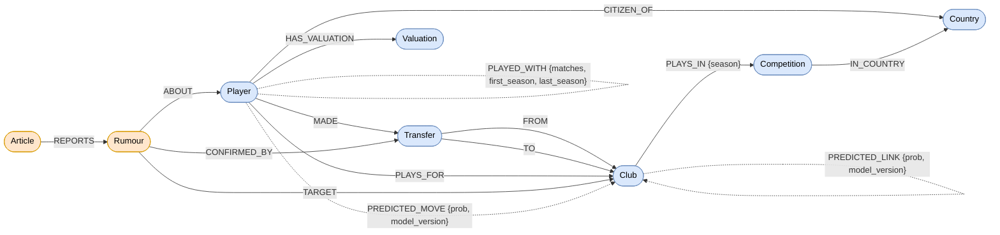

# Graph modeling

Owner: A. Why the graph looks the way it does. The contract itself (labels, keys, properties, indexes) is
`docs/schema.md`; the one-line ingestion choices are in `docs/decisions/a.md`.

The graph answers recruitment questions: who could replace a player, which clubs sell to which, who played with whom,
what the press says and whether it came true. Every modeling choice below starts from one of these questions.

## 1. The schema in one picture

Same content as `docs/schema.drawio` (open it in [draw.io](https://app.diagrams.net)). Solid boxes are facts from
Transfermarkt, dashed edges are derived from the facts, orange elements are hypotheses (press and model).



| Layer | Elements | Source | Shown by the agent as |
| --- | --- | --- | --- |
| Facts | `Player`, `Club`, `Competition`, `Country`, `Transfer`, `Valuation` and their relationships | Transfermarkt | verified |
| Derived | `PLAYED_WITH`, `SENDS_TO`, `pagerank`, `community_id`, `embedding` | computed from the facts | verified (computed) |
| Hypotheses | `Article`, `Rumour`, `PREDICTED_MOVE`, `PREDICTED_LINK` | press + LLM, link prediction model | rumour or predicted |

## 2. Modeling choices and rejected alternatives

### 2.1 A transfer is a node, not a relationship

| Option | Verdict |
| --- | --- |
| `(:Player)-[:TRANSFERRED {date, fee}]->(:Club)` | rejected |
| `(:Club)-[:TRANSFERRED {player_id, date, fee}]->(:Club)` | rejected |
| `(:Player)-[:MADE]->(:Transfer)-[:FROM]->(:Club)`, `(:Transfer)-[:TO]->(:Club)` | **kept** |

A transfer involves three entities (player, origin club, destination club) and a relationship has only two ends:
the player-to-club edge loses the origin, the club-to-club edge turns the player into a plain id that cannot be
traversed. A transfer is also the **target** of other facts: a confirmed rumour points to it with
`CONFIRMED_BY`, and a relationship cannot point to a relationship in Neo4j. As a node it carries its own key
(`transfer_id`, a stable hash), so `MERGE` makes the ingestion idempotent, and an index on `Transfer(date)` serves
the "pipeline since" queries.

Cost: one more hop (`(p)-[:MADE]->(t)-[:TO]->(c)`). Each `Transfer` has exactly three relationships, so the extra
expansion is constant and cheap. For the club-to-club questions, which are the frequent ones, `SENDS_TO` (2.3) removes
the hop entirely.

### 2.2 Appearances are aggregated into `PLAYED_WITH`

| Option | Verdict |
| --- | --- |
| `(:Player)-[:APPEARED_IN]->(:Game)<-[:APPEARED_IN]-(:Player)` with 1.9 M appearances and 89 k games | rejected |
| `(:Player)-[:PLAYED_WITH {matches, first_season, last_season}]-(:Player)` computed before loading | **kept** |

The agent asks "did A and B play together, how often, when" and "how far is A from B through teammates". With
`Game` nodes, every such question becomes a two-hop join through games, recomputed at each request, and a 6-hop
teammate path becomes a 12-hop path through millions of nodes. The aggregation (self-join of appearances on game and
club, `a < b`) runs **once** in DuckDB, a columnar engine made for it, and Neo4j only stores the 360 k pairs.
Each pair is stored once, from the smaller to the larger id, and read without direction (`-[:PLAYED_WITH]-`).

What we give up: individual games (minutes, goals, lineups). No question of the project needs them, and the DuckDB
file stays the place to read them. Only league games of the scope count, so `matches` compares like with like.

### 2.3 `SENDS_TO` is materialised

| Option | Verdict |
| --- | --- |
| Aggregate `Transfer` nodes at query time | rejected for the API and GDS |
| `(:Club)-[:SENDS_TO {count, total_fee_eur}]->(:Club)` rebuilt at the end of every ingestion | **kept** |

"Which clubs sell to this club", "top sellers", PageRank, communities and link prediction all read a weighted
club-to-club network. Materialising it turns each of those into one hop, and the GDS projection becomes a plain
native projection of one relationship type. It is safe because it is never written by hand: the ingestion deletes
and rebuilds the `SENDS_TO` of the clubs it loads from the `Transfer` nodes, so it cannot drift from the facts.
Unknown fees are skipped by the sum, never counted as zero. Questions that need dates or loans still read `Transfer`.

### 2.4 The league depends on the season

| Option | Verdict |
| --- | --- |
| `Club.league` property, or one `(:Club)-[:PLAYS_IN]->(:Competition)` | rejected |
| `Competition` node per season (`Premier League 2022`) | rejected |
| `(:Club)-[:PLAYS_IN {season}]->(:Competition)`, one relationship per season played | **kept** |

Clubs are promoted and relegated: in scope, a club that went down in 2018 would be attached to the wrong league, or
to none, with a single property. The pipeline queries ("where do this league's players go") need the league of the
destination club **at the time of the transfer**, which is `PLAYS_IN {season: t.season}`. A competition node per
season would multiply nodes (7 x 12) for no gain: the season is an attribute of the participation, not of the league.

### 2.5 Hypotheses are kept apart from facts

| Option | Verdict |
| --- | --- |
| A rumour as a `Transfer` with `status = 'rumour'`, or a prediction as a `SENDS_TO` with a flag | rejected |
| Separate labels and types: `Article`, `Rumour`, `PREDICTED_MOVE`, `PREDICTED_LINK` | **kept** |

The agent must never present a rumour or a prediction as a fact. With a flag, every query on facts would need
`WHERE status = 'fact'`, and one forgotten filter would leak a rumour into an answer. With separate labels and types,
a query on `Transfer` or `SENDS_TO` cannot see a hypothesis at all. The link between both worlds is explicit and
one-way: a `Rumour` becomes true only when the confirmation job finds the matching `Transfer` and adds
`CONFIRMED_BY`; the rumour is never turned into a transfer. Predictions carry `model_version`, so a new model run
replaces its own edges without touching anything else.

### 2.6 Smaller choices

- **`Valuation` as a node** rather than a list property on `Player`: one node per (player, date), indexed by date,
  so the agent can read the trend and a value at a given date. The latest value is also copied to
  `Player.market_value_eur`, where the budget filter and its index need it.
- **`Country` as a node**: shared by players (`CITIZEN_OF`) and competitions (`IN_COUNTRY`), so "players of the
  same nationality as the league" is a pattern, not a string comparison. Codes are FIFA trigrams (Transfermarkt
  separates England, Scotland, Wales and Northern Ireland, ISO does not).
- **`PLAYS_FOR` is only the current club**: the history is the chain of `Transfer` nodes; storing it twice would
  allow the two to disagree.
- **Light clubs**: the other side of a scope transfer (a Saudi or MLS club) is a `Club` with id and name only, so
  every transfer keeps both ends; they have no `PLAYS_IN`.
- **Natural keys**: Transfermarkt ids for players and clubs, a stable hash for transfers, `<player_id>-<date>` for
  valuations. Ids survive a re-run, so `MERGE` updates instead of duplicating.

## 3. Data sources

### 3.1 Datasets

| Source | What we take | Link | License and terms |
| --- | --- | --- | --- |
| transfermarkt-datasets (David Cariboo) | the facts: competitions, clubs, games, appearances, players, transfers, market values | [GitHub](https://github.com/dcaribou/transfermarkt-datasets), [Kaggle](https://www.kaggle.com/datasets/davidcariboo/player-scores), [DuckDB file](https://pub-e682421888d945d684bcae8890b0ec20.r2.dev/data/transfermarkt-datasets.duckdb) | CC0-1.0 (public domain dedication). The data is scraped from [Transfermarkt](https://www.transfermarkt.com); we cite it as the origin and only use it for teaching. |
| The Guardian, football transfers RSS | press articles for rumours (role D) | [feed](https://www.theguardian.com/football/transfers/rss) | Guardian terms: the graph keeps the URL, title, date and one quoted sentence, never the full text. |
| BBC Sport, football RSS | same | [feed](https://feeds.bbci.co.uk/sport/football/rss.xml) | BBC terms, same use. |
| GDELT DOC 2.0 API | article search across outlets | [API](https://api.gdeltproject.org/api/v2/doc/doc) | free and open, with citation of the GDELT Project. |

Version used: the DuckDB file of transfermarkt-datasets at commit `e44f186d` (201 MB, 13 tables), downloaded by
`make data`. The upstream project has paused its updates: the data is current to **6 July 2026**, which is also the
date of the last game in the file. Transfers dated after the ingestion day are planned moves (ends of loan up to
2030) and are dropped (`docs/decisions/a.md`, A3).

Rumour extraction from the press uses an LLM (role D, `docs/guardrails.md`); the confirmation of rumours against the
Transfermarkt facts is deterministic Cypher (`scripts/confirm_rumours.py`).

### 3.2 Scope kept

| Setting | Value | Why |
| --- | --- | --- |
| `SCOPE_COMPETITIONS` | `GB1, ES1, IT1, L1, FR1, PO1, NL1` (England, Spain, Italy, Germany, France, Portugal, Netherlands) | the "big five" plus the two main selling leagues of Europe, so the network shows where clubs buy |
| `SCOPE_FROM_SEASON` | `2015` | ten full seasons: enough history for link prediction, small enough to load in about a minute |
| Clubs | 223 that played a league game of the scope, plus 2,009 light clubs on the other side of a transfer | read from `games`, not from the current league of `clubs`, so relegated clubs are kept |
| Players | 17,856 | appeared for a scope club, made a scope transfer, or still play for a scope club |
| Games | 26,421 league games, 771,697 appearances, not loaded | aggregated into 359,707 `PLAYED_WITH` pairs |
| Valuations | from 1 January 2015 on | same time window as the transfers |

Both settings are environment variables (`.env.example`): the same code loads a smaller scope for a quick demo.

### 3.3 Ingestion numbers

Run of 2026-10-20 on the full file, empty local Neo4j 5 (2 GB heap), `make seed`.

| Nodes | Count | Relationships | Count |
| --- | --- | --- | --- |
| `Player` | 17,856 | `PLAYED_WITH` | 359,707 |
| `Club` | 2,232 | `HAS_VALUATION` | 250,988 |
| `Transfer` | 34,744 (17,833 flagged as loans) | `MADE`, `FROM`, `TO` | 34,744 each |
| `Valuation` | 250,988 | `SENDS_TO` | 22,713 |
| `Country` | 166 | `PLAYS_FOR` | 17,850 |
| `Competition` | 7 | `CITIZEN_OF` | 17,718 |
| | | `PLAYS_IN` | 1,468 |
| | | `IN_COUNTRY` | 7 |
| **Total** | **305,993** | **Total** | **774,683** |

Duration: **1 min 12 s** (DuckDB extraction 3.8 s, facts 39 s, derived relationships 27 s). A second run gives
exactly the same counts (idempotent). Data quality on the scope: 5,005 transfers outside the seasons, 24 in the
future, 1,088 with a placeholder club ("Without Club", "Retired"...) and 11 duplicates dropped; 4,270 kept
transfers have an unknown fee, stored as `null`.

## Appendix · anti-genericity check

**Protocol.** On 2026-10-21 a fresh sub-agent (no access to the repository, no tool, no conversation history)
received only this sentence, the one-line pitch of the project: *"Neo4j graph of football transfers and a
recruitment agent. Propose a graph schema for this."* Its answer is pasted below as is, then compared point by point
with `docs/schema.md`. The goal is to show which parts of our schema any model would produce, and which come from
the data we actually have and the questions we actually answer.

### A.1 The generic answer (verbatim)

> ## Proposed Neo4j schema: football transfers graph and recruitment agent
>
> The main design choice is to store each **Transfer as its own node**, not as a relationship. A transfer links a player, two clubs, a date, a window, a fee, a type and sometimes an agent. A node can connect to all of these, can be indexed, and lets the agent run queries like "all transfers from Ligue 1 to the Premier League over €20m".
>
> ### Node labels (key properties)
>
> | Label | Properties |
> |---|---|
> | `Player` | `player_id` (unique), `name`, `birth_date`, `foot`, `height_cm`, `main_position`, `market_value_eur`, `market_value_date` |
> | `Club` | `club_id` (unique), `name`, `founded`, `stadium`, `budget_tier` (optional) |
> | `League` | `league_id`, `name`, `tier`, `strength_coef` (for example, the UEFA coefficient) |
> | `Country` | `code` (ISO), `name`, `eu_member` (useful for work-permit and non-EU quota rules) |
> | `Season` | `season_id` (for example `"2024-25"`), `start_date`, `end_date` |
> | `Transfer` | `transfer_id`, `date`, `window` (`summer`/`winter`), `fee_eur`, `fee_type` (`permanent`/`loan`/`free`/`loan_with_option`), `add_ons_eur`, `is_fee_disclosed` |
> | `Position` | `code` (`GK`, `CB`, `LB`, `DM`, `CM`, `AM`, `LW`, `RW`, `ST`...), `line` (`DEF`/`MID`/`ATT`) |
> | `Agent` | `agent_id`, `name`, `agency` |
> | `Contract` | `start_date`, `end_date`, `wage_eur_week` (optional) |
> | `SeasonStats` | `minutes`, `apps`, `goals`, `assists`, `xG`, `xA`, `progressive_passes`, `tackles`, ... (one node per player, season and club) |
> | `Coach` (optional) | `name`, `preferred_formation` |
> | `ScoutingNeed` (agent side) | `need_id`, `position`, `max_fee`, `max_age`, `min_minutes`, `created_at`, `status` |
>
> ### Relationships
>
> ```
> (:Transfer)-[:OF_PLAYER]->(:Player)
> (:Transfer)-[:FROM_CLUB]->(:Club)
> (:Transfer)-[:TO_CLUB]->(:Club)
> (:Transfer)-[:IN_SEASON]->(:Season)
> (:Transfer)-[:BROKERED_BY]->(:Agent)
>
> (:Player)-[:PLAYED_FOR {from, to, on_loan}]->(:Club)      // spells, derived from transfers
> (:Player)-[:HAS_CONTRACT]->(:Contract)-[:WITH_CLUB]->(:Club)
> (:Player)-[:PLAYS_POSITION {primary: bool, minutes_share}]->(:Position)
> (:Player)-[:NATIONAL_OF]->(:Country)
> (:Player)-[:REPRESENTED_BY]->(:Agent)
> (:Player)-[:HAS_STATS]->(:SeasonStats)-[:FOR_SEASON]->(:Season)
> (:SeasonStats)-[:AT_CLUB]->(:Club)
>
> (:Club)-[:COMPETES_IN {season}]->(:League)
> (:League)-[:IN_COUNTRY]->(:Country)
> (:Club)-[:COACHED_BY {from, to}]->(:Coach)
>
> // Derived / analytic edges (computed, e.g. with Neo4j GDS)
> (:Player)-[:SIMILAR_TO {score, method}]->(:Player)        // kNN / node similarity on stats
> (:Club)-[:TRADES_WITH {n_transfers, total_fee}]->(:Club)  // aggregated transfer corridor
> (:Club)-[:FEEDER_OF {n_transfers}]->(:Club)
>
> // Recruitment agent
> (:ScoutingNeed)-[:FOR_CLUB]->(:Club)
> (:ScoutingNeed)-[:CANDIDATE {score, rationale, created_at}]->(:Player)
> ```
>
> ### Constraints and indexes
>
> ```cypher
> CREATE CONSTRAINT player_id IF NOT EXISTS FOR (p:Player) REQUIRE p.player_id IS UNIQUE;
> CREATE CONSTRAINT club_id   IF NOT EXISTS FOR (c:Club)   REQUIRE c.club_id IS UNIQUE;
> CREATE CONSTRAINT transfer_id IF NOT EXISTS FOR (t:Transfer) REQUIRE t.transfer_id IS UNIQUE;
> CREATE CONSTRAINT league_id IF NOT EXISTS FOR (l:League) REQUIRE l.league_id IS UNIQUE;
> CREATE INDEX transfer_date IF NOT EXISTS FOR (t:Transfer) ON (t.date);
> CREATE INDEX transfer_fee  IF NOT EXISTS FOR (t:Transfer) ON (t.fee_eur);
> CREATE FULLTEXT INDEX player_name IF NOT EXISTS FOR (p:Player) ON EACH [p.name];
> // Optional: a vector index on a Player.embedding property for semantic or stat-based similarity
> ```
>
> ### How the recruitment agent uses the graph
>
> These are the main queries it would run, as tools:
>
> 1. **Find candidates.** Search players by position, age, contract expiry (a contract ending within 12 months usually means a lower fee), market value and minutes. Filter on `PLAYS_POSITION`, `HAS_CONTRACT` and `SeasonStats`.
> 2. **Find replacements.** "Find players like X": follow `SIMILAR_TO` from a departing player, filtered by budget.
> 3. **Check transfer corridors.** Which clubs a target club often buys from, using `TRADES_WITH` and `FEEDER_OF`. These suggest realistic sources and existing relationships.
> 4. **Check agent links.** Whether a candidate's agent has already brokered deals with the club: `(club)<-[:TO_CLUB]-(:Transfer)-[:BROKERED_BY]->(a)<-[:REPRESENTED_BY]-(candidate)`.
> 5. **Compare fees.** Fees for similar transfers by position, age band and league, used to estimate a realistic price.
> 6. **Adjust for league strength.** Scale a player's stats by `League.strength_coef` when comparing across leagues.
> 7. **Record recommendations.** Write `CANDIDATE` edges on a `ScoutingNeed` with a score and rationale. This keeps an audit trail, lets the agent remember earlier results and lets people give feedback.
>
> Example query (cheap, young left-backs whose contract ends next summer):
> ```cypher
> MATCH (p:Player)-[:PLAYS_POSITION {primary:true}]->(:Position {code:'LB'}),
>       (p)-[:HAS_CONTRACT]->(k:Contract)-[:WITH_CLUB]->(c:Club)-[:COMPETES_IN]->(l:League)
> WHERE date().year - p.birth_date.year <= 23
>   AND k.end_date <= date('2027-06-30')
>   AND p.market_value_eur <= 15000000
> MATCH (p)-[:HAS_STATS]->(s:SeasonStats)-[:FOR_SEASON]->(:Season {season_id:'2025-26'})
> WHERE s.minutes >= 1500
> RETURN p.name, c.name, l.name, p.market_value_eur, s.minutes, s.xA
> ORDER BY s.xA DESC LIMIT 20;
> ```
>
> ### Design notes
> - Keep `PLAYED_FOR` as a derived shortcut built from the `Transfer` nodes. `Transfer` stays the source of truth, and the shortcut makes career-path queries simpler.
> - Put stats on `SeasonStats` nodes, not on `Player`. This keeps the history over time and supports per-club splits when a player moves mid-season.
> - Store money as integers in EUR with a currency field, and keep the date of each market value.
> - Loans: model them as a `Transfer` with `fee_type:'loan'` plus a later return `Transfer`. Loan-to-buy deals get `fee_type:'loan_with_option'`.
> - Leave out `Coach`, `Agent` and `Contract` wages at first if the data source (for example Transfermarkt scrapes or Kaggle datasets) does not have them. The core is Player, Club, League, Transfer, Season and SeasonStats.

### A.2 Where we agree

| Generic proposal | Ours | Comment |
| --- | --- | --- |
| `Transfer` as a node, "not as a relationship" | same (2.1) | The obvious choice, for the same reason: a transfer has three ends. We add a fourth reason the generic answer does not have: a `Rumour` points to it with `CONFIRMED_BY`. |
| `(:Transfer)-[:OF_PLAYER]->(:Player)`, `FROM_CLUB`, `TO_CLUB` | `(:Player)-[:MADE]->(:Transfer)`, `FROM`, `TO` | Naming only. Our direction reads as a path in time: `(p)-[:MADE]->(t)-[:TO]->(c)`. |
| `(:Club)-[:COMPETES_IN {season}]->(:League)`, `(:League)-[:IN_COUNTRY]->(:Country)` | `(:Club)-[:PLAYS_IN {season}]->(:Competition)`, `IN_COUNTRY` | Same idea (2.4). `Competition` is the Transfermarkt term, and its ids (`GB1`, `FR1`) are our keys. |
| `TRADES_WITH {n_transfers, total_fee}` "aggregated transfer corridor" | `SENDS_TO {count, total_fee_eur}` | Same idea (2.3). Ours is directed (who sells to whom) and skips unknown fees instead of counting them as 0. `FEEDER_OF {n_transfers}` is the same edge with fewer properties: not needed. |
| Uniqueness on `player_id`, `club_id`, `transfer_id`, range index on `Transfer(date)`, full-text on player names | same, plus 5 more | We also have `Club` full-text (the agent resolves club names too), the composite `Player(position, date_of_birth)` for the candidate search, `Player(market_value_eur)` for the budget, `Rumour(status)` for the confirmation job. |
| Money as integer euros; keep the date of each market value | `fee_eur`, `value_eur` integers; `Valuation` nodes | We keep the whole history of values (250,988 `Valuation`), not only the latest date. |

### A.3 Where we differ, and why

| Generic proposal | Our choice | Why |
| --- | --- | --- |
| No rumours, no press, no predictions | `Article`, `Rumour`, `PREDICTED_MOVE`, `PREDICTED_LINK`, `CONFIRMED_BY` | The biggest gap. Our agent answers "what does the press say" and "where could he go", and must label each claim verified, predicted or rumour. The generic schema has only facts, so it has nowhere to put a hypothesis without mixing it with facts (2.5). |
| No teammate network | `PLAYED_WITH {matches, first_season, last_season}` (359,707 pairs) | Teammate paths ("how is A connected to B"), the FastRP embedding of role C and similar players all come from it. The generic answer sees players only through clubs. |
| `Season` node, `(:Transfer)-[:IN_SEASON]->(:Season)` | `season` integer on `Transfer` and `PLAYS_IN` | A `Season` node is a supernode (each one linked to about 3,000 transfers) and adds a hop to what is a range filter; `Transfer(date)` is indexed and serves "since 2022" directly. |
| `Position` node with `PLAYS_POSITION {primary, minutes_share}` | `position`, `sub_position` properties | Transfermarkt gives one position and one sub-position per player, no minutes share. Four position nodes would each hold thousands of edges; a property with the composite index `(position, date_of_birth)` serves "defenders under 23" with one index seek. |
| `SeasonStats` nodes (minutes, goals, xG, xA, tackles...) | not loaded | The file has goals, assists and minutes per appearance, no xG, xA or defensive stats. Our questions use who played with whom, not output per season, so appearances are aggregated into `PLAYED_WITH` only. Possible addition (add-only): minutes and goals per (player, season) from the same DuckDB aggregation. |
| `Agent` node, `BROKERED_BY`, `REPRESENTED_BY` | not modeled | `transfers` has no agent column, so `BROKERED_BY` cannot be built. `players.agent_name` is the **current** agent only (65% of current players): a possible `Player.agent_name` property, but no history to make "this agent already dealt with this club" true. |
| `Contract` node with wages | not modeled | No wages in the data. `players.contract_expiration_date` is a current snapshot (77% of current players): a natural add-only `Player` property for "contract ending soon", not done for lack of time. |
| `Coach` with `COACHED_BY {from, to}` | not modeled | `clubs.coach_name` is the current coach of half of the clubs, with no dates. |
| `PLAYED_FOR {from, to, on_loan}` spells derived from transfers | `PLAYS_FOR` = current club only; history = chain of `Transfer` | Two copies of the career could disagree, and spells built from transfers break on loans and on missing records. Our `is_loan` flag answers the loan question on the `Transfer` itself. |
| `fee_type` (`permanent` / `loan` / `free` / `loan_with_option`), `is_fee_disclosed` | `is_loan` (inferred), `fee_eur` (`0` = free, `null` = unknown) | The generic schema assumes the source marks loans. Transfermarkt-datasets does not: we infer loans with a rule checked by hand (A3, 17,833 transfers flagged). `null` vs `0` already says whether the fee is known, without a second property that could contradict it. |
| `window` (`summer` / `winter`) | not stored | Derived from `date` when needed; storing it would duplicate the date. |
| `Country.code` ISO, `eu_member` | FIFA trigram | Transfermarkt nationalities include England, Scotland, Wales and Northern Ireland, which ISO 3166 merges. EU membership answers no question of the project. |
| `League.tier`, `strength_coef` | none | All seven scope leagues are top tiers; no UEFA coefficient in the data. |
| `SIMILAR_TO {score, method}` stored edges | `Player.embedding` (FastRP, role C), cosine at query time | Stored kNN edges must be recomputed for every player when the graph changes; an embedding property lets `/similar` compute the top k for one player on demand. |
| `ScoutingNeed`, `CANDIDATE {score, rationale}` written by the agent | nothing written by the agent | Our agent is **read-only** by design (`docs/guardrails.md`: write clauses refused, read transactions). Recommendations are answers with evidence ids (`Player:12`), not graph data, so a wrong LLM output can never become a fact. |
| Example query: `date().year - p.birth_date.year <= 23`, literals in the query | age compared on the full date of birth, `$params` only | The year difference is off by up to a year; literals in Cypher are what our contract forbids (injection, no plan cache). |

### A.4 What we take from it

The generic answer is a good *data-rich* schema for an ideal source: half of its labels (`Agent`, `Contract`,
`SeasonStats` with xG, `Coach` history) have no data behind them in transfermarkt-datasets. Our schema is smaller
because each element is backed by a column we actually load, and wider where the project is specific: three
separate levels of truth, a rumour confirmed against a fact, and a teammate network built from 1.9 M appearances.
Two of its ideas are cheap, add-only improvements we would make next: `Player.contract_expiration_date` and
per-season minutes and goals for the candidate search.
