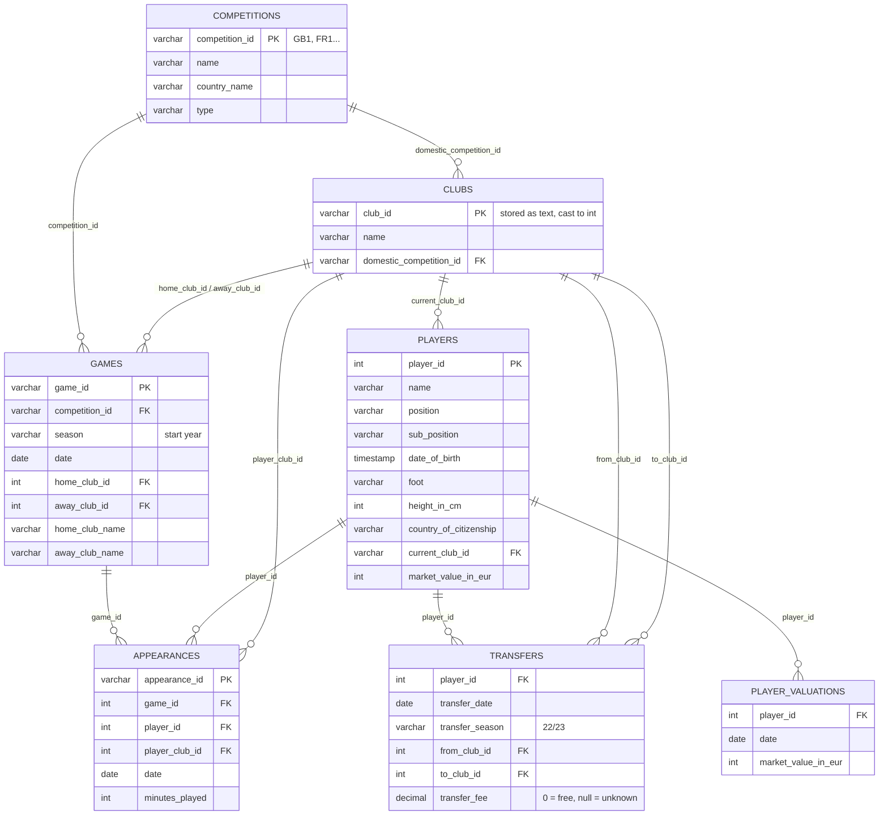
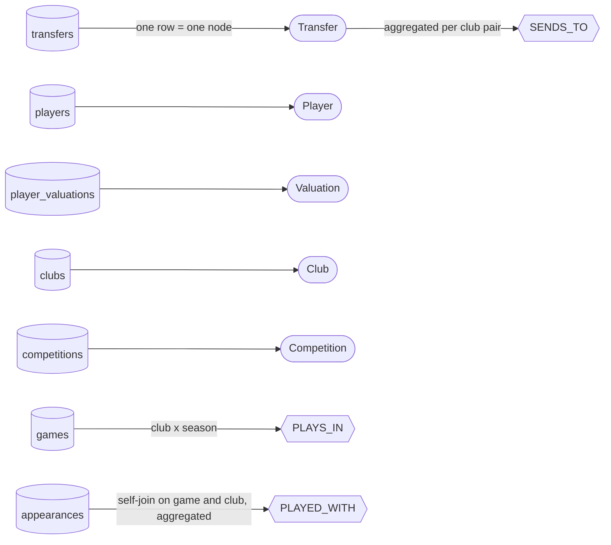

# Source data: ER diagram and mapping to the graph

The project starts from relational data, the [transfermarkt-datasets](https://github.com/dcaribou/transfermarkt-datasets)
DuckDB file (`make data`, 13 tables). The assignment asks for an ER diagram in that case: it is below, drawn from
the file itself (`information_schema`, row counts of the file used for this project). The modeling choices that turn
these tables into the graph are explained in [`modeling.md`](modeling.md); the graph contract is
[`schema.md`](schema.md).

DuckDB declares no foreign keys: the relations below are the logical keys the ingestion (`scripts/seed_data.py`)
joins on.

## Tables the ingestion reads

| Table | Rows in the file | Used for |
| --- | ---: | --- |
| `competitions` | 65 | `Competition` nodes (the 7 scope leagues), `IN_COUNTRY` |
| `clubs` | 796 | `Club` names |
| `games` | 88,958 | the scope (league games of 7 competitions since 2015) and `PLAYS_IN {season}` |
| `appearances` | 1,894,350 | aggregated in DuckDB into `PLAYED_WITH` pairs, never loaded row by row |
| `players` | 50,149 | `Player` nodes, `PLAYS_FOR` (current club), `CITIZEN_OF` |
| `transfers` | 175,165 | `Transfer` nodes, `MADE` / `FROM` / `TO`, then `SENDS_TO` |
| `player_valuations` | 656,301 | `Valuation` nodes, `HAS_VALUATION` |

`transfers` has no primary key: the graph gives each move a stable id, `transfer_id` = 16 hex digits of
sha1(player | date | from | to). `player_valuations` gets `valuation_id` = `<player_id>-<date>`.

## Tables the ingestion leaves out

| Table | Rows | Why it is not loaded |
| --- | ---: | --- |
| `club_games` | 177,916 | per-club view of `games`; the scope and `PLAYS_IN` already come from `games` |
| `game_events` | 1,274,469 | goals, cards and substitutions: no question of the project uses them |
| `game_lineups` | 3,179,016 | starting line-ups; `appearances` already gives who played for which club |
| `countries` | 124 | country names come from the citizenship strings, normalised by `scripts/country_codes.py` |
| `national_teams` | 124 | national teams are out of scope |
| `version` | 1 | dataset commit hash, recorded in `docs/modeling.md` |

## From tables to graph

The relational source keeps one row per event; the graph keeps the entities, the transfer as a node of its own,
and two relationships pre-aggregated from millions of rows (`PLAYED_WITH`, `SENDS_TO`). Row counts of the graph
after ingestion: `docs/modeling.md`, section 3.3.
